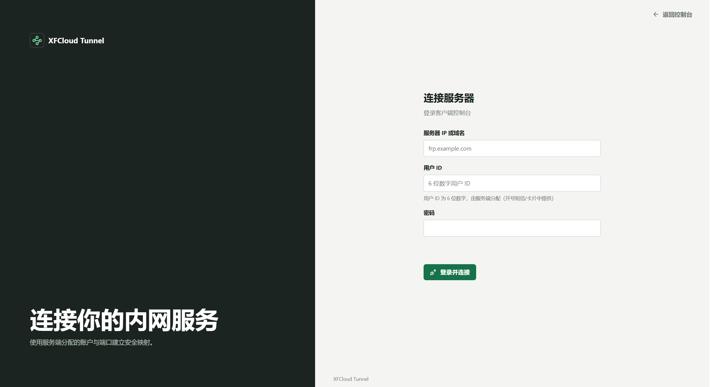
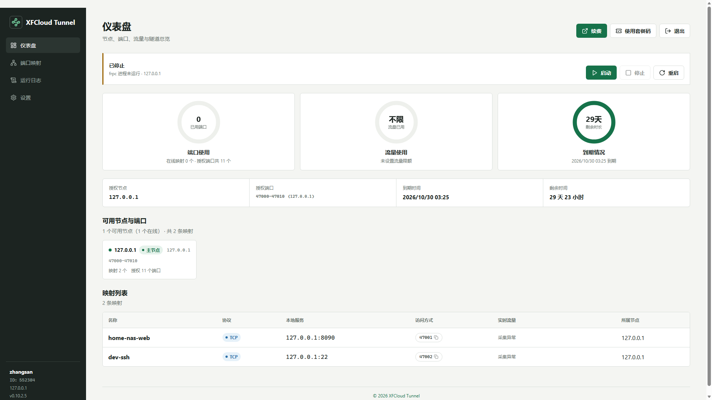
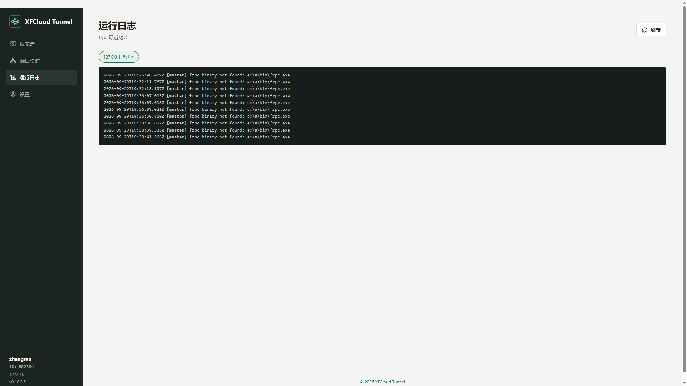
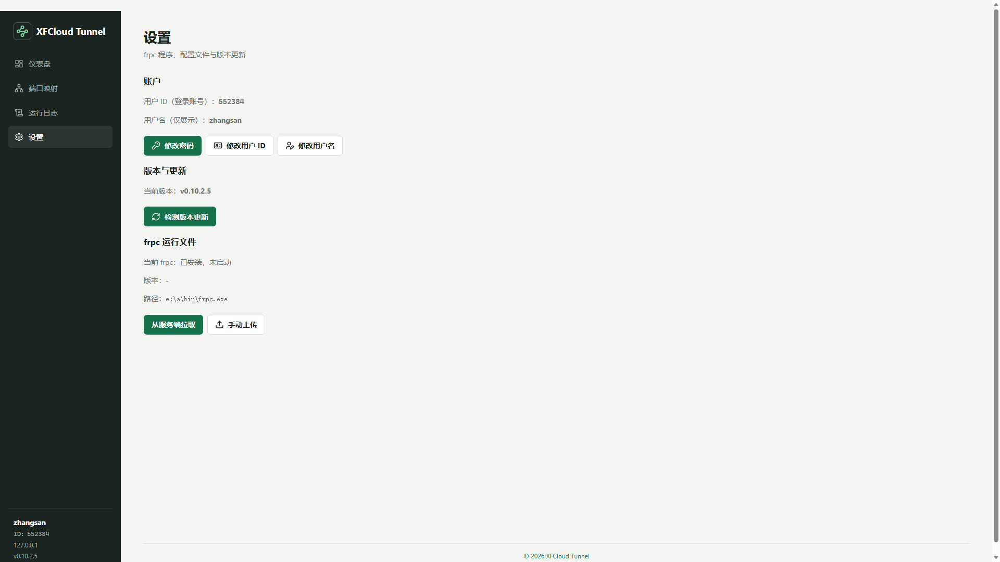

# XFCloud Tunnel 客户端（xfcloud-client）

    

连接 [XFCloud Tunnel 服务端](https://github.com/xfcloud001/xfcloud-server) 即可为内网服务建立 frp 隧道：Web 控制台可视化编辑端口映射，登录即用；本地状态 AES-256-GCM 加密落盘；未登录时也可作为自定义 frpc 启动器使用。

- 服务端仓库：[xfcloud-server](https://github.com/xfcloud001/xfcloud-server)
- 官网（产品介绍 / 图文教程 / 飞牛 fpk 下载）：**<https://www.xfhub.top>**
- 图文部署教程：**<https://www.xfhub.top/tutorial>**

## 界面预览

| 登录与连接 | 端口映射 |
| --- | --- |
|  |  |
| **运行日志** | **设置中心** |
|  |  |

> 更多截图与在线演示说明见官网：<https://www.xfhub.top>

## 功能特性

- **一键登录集群**：输入服务端地址与账号即可连接，frpc 配置自动生成（配置文件运行后即删，不落明文）
- **端口映射可视化编辑**：TCP / UDP / HTTP / HTTPS，按授权端口段约束
- **多节点与集群**：多个授权节点分块管理，主节点切换后客户端凭集群 id 自动跟随新主
- **信息中心**：接收服务端公告与本地运行提醒；frpc 报错自动聚合（10 分钟去重），连接池死连接自愈（60 秒内高频报错自动重启 frpc）
- **运行日志**：多进程页签查看 frpc 实时输出
- **安全**：本地配置 AES-256-GCM 加密落盘、frpc 本机锁（锁定后配置不可读写）
- **自定义 frpc 模式**：未登录也可手写 frpc 配置直接运行
- **零第三方依赖**：仅 Node.js 内置模块

## 环境要求

- Node.js **22.5+**（依赖内置 `node:sqlite`，无需 `npm install`）

## 快速开始

```bash
git clone https://github.com/xfcloud001/xfcloud-client.git
cd xfcloud-client
npm start            # 等价于 node --experimental-sqlite client/app.js
```

浏览器访问 `http://127.0.0.1:7400`，登录服务端地址与账号即可开始建隧道。

frpc 二进制可在控制台一键安装，也可通过环境变量 `FRPC_BIN` 指定本地路径；显式指定的路径不会被自动更新覆盖。

> Windows / 飞牛 NAS 用户推荐直接下载 fpk 安装包：**<https://www.xfhub.top>**（应用中心一键安装，内置 Node.js 22 与 frp 内核）

### 端口与地址

| 来源 | 说明 |
| --- | --- |
| 命令行 | `node client/app.js --port=8400 --host=127.0.0.1` |
| 环境变量 | `CLIENT_PORT`（默认 `7400`）、`CLIENT_HOST`（默认 `0.0.0.0`） |
| 配置文件 | `data/client/config.json`（`{ "port": 7400, "host": "0.0.0.0" }`） |

## 飞牛 fnOS 用户

服务端与客户端均提供飞牛 fnOS 原生 fpk 应用包（内置 Node.js 22 与 frp 内核），飞牛应用中心手动安装即用，数据持久化、升级不丢失 —— 见官网 <https://www.xfhub.top>。

## 关键词 / Keywords

内网穿透 · frp 客户端 · frpc 图形界面 · NAT 穿透 · 端口映射 · 端口转发 · 隧道 · 远程访问 · NAS 远程 · 飞牛 fnOS · fpk 应用 · frpc 可视化 · 内网服务暴露 · 自建隧道 · intranet penetration · nat traversal · frp client gui · port forwarding · remote access · tunnel client

## License

本项目基于 [AGPL-3.0](./LICENSE) 协议开源。frp 内核版权归其原作者所有。
